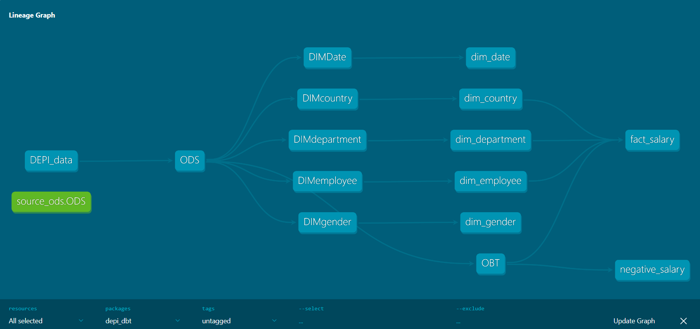

# DEPI dbt Project: Employee Salary Data Warehouse

A dbt project that builds a layered data warehouse on **SQL Server** from a raw employee salary dataset (3,000 records), following the ODS → Staging → DWH pattern.

## Architecture

```
DEPI_data (seed) → ods.ODS → stg.* (dimensions + OBT) → dwh.* (star schema)
```

| Layer | Schema | Models |
|-------|--------|--------|
| Seed | dbo | `DEPI_data` |
| ODS | ods | `ODS` |
| Staging | stg | `DIMcountry`, `DIMDate`, `DIMdepartment`, `DIMemployee`, `DIMgender`, `OBT` (incremental) |
| DWH | dwh | `dim_country`, `dim_department`, `dim_employee`, `dim_date`, `dim_gender`, `fact_salary` |
|
## Tech Stack

- dbt Core 1.12.6
- dbt-sqlserver 1.12.1
- SQL Server + SSMS
- Python virtual environment

## Key Features

- Separate `schema.yml` for each layer (ODS, STG, DWH) with descriptions
- **Generic tests:** `unique`, `not_null`, `accepted_values`, `relationships` (fact table to dimensions)
- **Singular test:** `tests/negative_salary.sql` checks for negative salaries
- **Custom macros:**
  - `generate_schema_name`: uses the custom schema name as-is (no `dbo_` prefix)
  - `capitalize_name(first_col, last_col)`: builds a properly capitalized `full_name`
- Incremental model (`OBT`)
- Full documentation with lineage graph

## Build Results

`dbt build`: **PASS=54, WARN=0, ERROR=0** (1 seed, 13 models, 40 tests)

## How to Run

```bash
# 1. Activate the virtual environment
.\.venv\Scripts\activate

# 2. Install dependencies
pip install dbt-core dbt-sqlserver

# 3. Configure your connection in ~/.dbt/profiles.yml
#    (SQL Server, database: DEPI_DW, Windows authentication)

# 4. Run everything
cd depi_dbt
dbt seed
dbt build

# 5. Generate and view documentation
dbt docs generate
dbt docs serve
```

## Lineage Graph



## Author

**Abdelrahman Ahmed Elsayed**